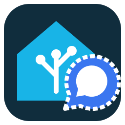

# CallMeBot Signal

Beta Home Assistant app **0.1.2**, in the same repository as CallMeBot Whatsapp and Blocks for HA. Original UGSo implementation inspired by [ioBroker.signal-cmb](https://github.com/derAlff/ioBroker.signal-cmb). No ioBroker runtime required.

DE/EN/FR Ingress UI, recipient profiles with international phone numbers or Signal UUIDs, separate Signal API keys and MQTT namespace. Matching **Signal · CallMeBot** block and profile picker in Blocks for HA **0.1.50**. WhatsApp profiles/keys are not reused.



- [Deutsch](https://opensource.ugso-software.de/projects/callmebot-signal/)
- [English](https://opensource.ugso-software.de/en/projects/callmebot-signal/)
- [Français](https://opensource.ugso-software.de/fr/projects/callmebot-signal/)
- [Setup and protocol in DE/EN/FR](DOCS.md)

## Development

```sh
python -m pip install -r callmebot_signal/requirements.txt
python -m unittest discover -s callmebot_signal/tests -v
node --test callmebot_signal/tests/request-id.test.mjs
docker build -t ugso-callmebot-signal:test callmebot_signal
```

Local preview: set CALLMEBOT_NO_MQTT=1 and CALLMEBOT_PORT=4183; use a temporary CALLMEBOT_DATA directory, then run python callmebot_signal/app/server.py. Browser tests intercept send requests and use dummy keys. No real messages in automated tests.

## Beta: history, profile backup and MQTT TLS

History persists up to 200 entries with timestamp, profile ID, source and result. Filter by profile/error status and explicitly confirm clearing. It contains no messages, numbers, API keys or request IDs. Accepted still means provider acceptance, not confirmed delivery. A storage error never causes automatic resending.

Profile backups encrypt numbers, API keys and the default profile using AES-GCM and a password-derived key (scrypt). Choose at least 12 characters and keep the password separately; it is not stored. Restoration requires it, explicit confirmation and valid authenticated content. Wrong passwords, damaged files or backups from the other CallMeBot app leave profiles untouched. Pending sends block restoration. MQTT credentials and history are excluded; use a full HA app backup for those.

Automatic HA broker selection remains the existing default. Disable it to configure an external host, port, username and password. TLS always checks certificates and hostname; custom PEM CA and client certificate/key uploads are supported. Choose the broker TLS port, often 8883. Empty secret fields preserve saved values. HA/Blocks must use this broker or forward send/result/profile/discovery topics between brokers; this is not an automatic broker bridge.

Existing profiles.json, recipient keys, MQTT topics and entity IDs remain unchanged. History uses /data/history.json; explicitly saved MQTT settings use /data/mqtt.json. No automatic configuration rewrite. All new UI labels support DE/EN/FR.

Beta is displayed in the UI and description. HA has no native beta stage, so the valid experimental configuration stage remains. [HA configuration](https://developers.home-assistant.io/docs/apps/configuration/).
